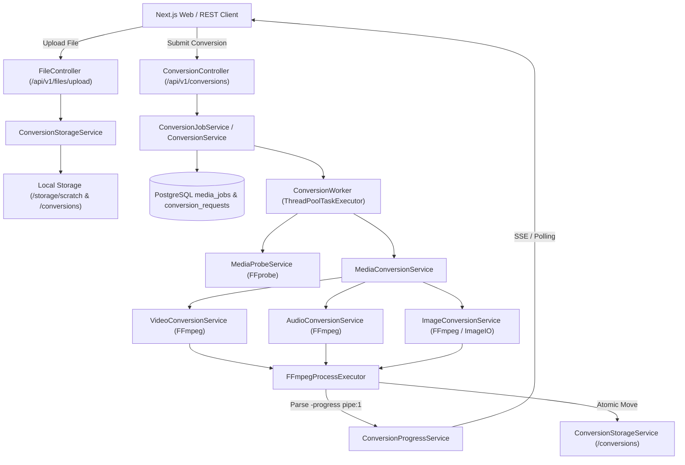

# MediaForge Phase 05 — Online Media Converter Architecture

## 1. Overview
The MediaForge Media Conversion Engine is a server-side media processing subsystem built using Spring Boot, PostgreSQL, and native FFmpeg/FFprobe binaries. It supports processing video, audio, and image transformations, single-file and batch conversions, live progress tracking, and cooperative task cancellation.

## 2. Core Components

### 2.1 File Storage Subsystem (`ConversionStorageService`)
- **Location:** `com.mediaforge.backend.converter.service.ConversionStorageService`
- **Responsibilities:**
  - Validates file signatures (magic bytes) to reject executable headers (PE `MZ`, ELF, Unix scripts).
  - Enforces strict path normalization (`toRealPath()` / canonical check) preventing directory traversal attacks.
  - Allocates temporary files in isolated scratch directories (`/app/storage/scratch`).
  - Atomically moves completed outputs to permanent conversion directories (`/app/storage/conversions`).
  - Executes automated cleanup tasks (reaping expired media after 24 hours).

### 2.2 Media Metadata Prober (`MediaProbeService`)
- **Location:** `com.mediaforge.backend.converter.service.MediaProbeService`
- **Execution:** Invokes `ffprobe -v quiet -print_format json -show_format -show_streams <path>` with structured array arguments.
- **Data Extracted:**
  - Duration in seconds (`format.duration`).
  - Video streams: dimensions (width, height), codec, frame rate (`r_frame_rate`), bitrate.
  - Audio streams: codec, sample rate, channels, bitrate.
  - Container format and size.
- **Decompression Bomb Protection:** Validates image dimensions, rejecting files exceeding 16,384px or 100,000,000 pixels before heavy processing occurs.

### 2.3 Process Execution & Progress Parsing (`FFmpegProcessExecutor`)
- **Location:** `com.mediaforge.backend.converter.service.FFmpegProcessExecutor`
- **Execution:**
  - Direct `ProcessBuilder` execution with `List<String>` argument arrays (never shell interpolation `cmd.exe /c` or `/bin/sh -c`).
  - Passes `-progress pipe:1 -nostats` to stream structured progress metrics over stdout.
  - Parses real-time keys: `out_time_us`, `total_size`, `fps`, `speed`.
  - Calculates true percentage: `(outTimeSeconds / totalDurationSeconds) * 100.0`.
  - Maintains `ConcurrentHashMap<UUID, Process>` enabling immediate cooperative cancellation via `destroyForcibly()`.

### 2.4 Conversion Services
- **`VideoConversionService`**:
  - Handles `mp4`, `webm`, `mkv`, `mov`, `avi`.
  - Supports resolution constraints without upscaling: maintains source aspect ratio while guaranteeing even pixel dimensions using `scale=-2:<targetHeight>` for H.264 / VP9 compatibility.
  - Fast-start optimization (`-movflags +faststart`) for streaming web playback.
  - Optional audio stripping (`-an`).
- **`AudioConversionService`**:
  - Converts audio files (`mp3`, `wav`, `aac`, `flac`, `m4a`, `ogg`).
  - Supports extracting audio soundtracks from video files via `-vn`.
  - Custom bitrates (64k to 320k) and sample rates (44.1 kHz, 48 kHz, 96 kHz).
- **`ImageConversionService`**:
  - Converts images (`jpg`, `png`, `webp`, `avif`).
  - Supports quality adjustment, dimensions resizing, and 90/180/270 degree rotation.

### 2.5 Job Management & Batch Processing (`ConversionJobService`)
- Manages single-job submissions and bulk multi-file batch conversions.
- Creates shared `batchId` for grouped jobs.
- Provides batch archive packaging (`GET /api/v1/conversions/batch/{batchId}/zip`) into compressed ZIP streams without intermediate disk bloat.
