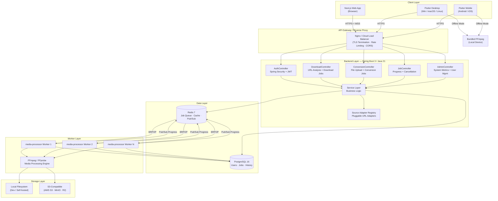
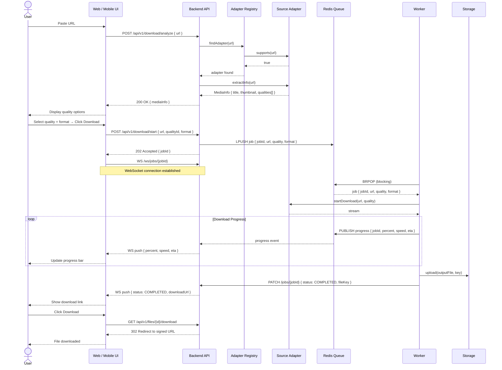
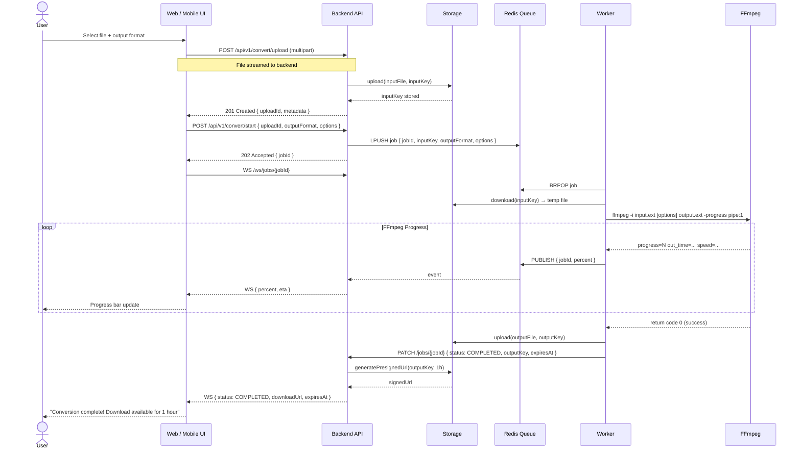
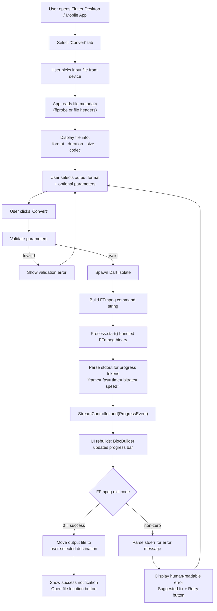
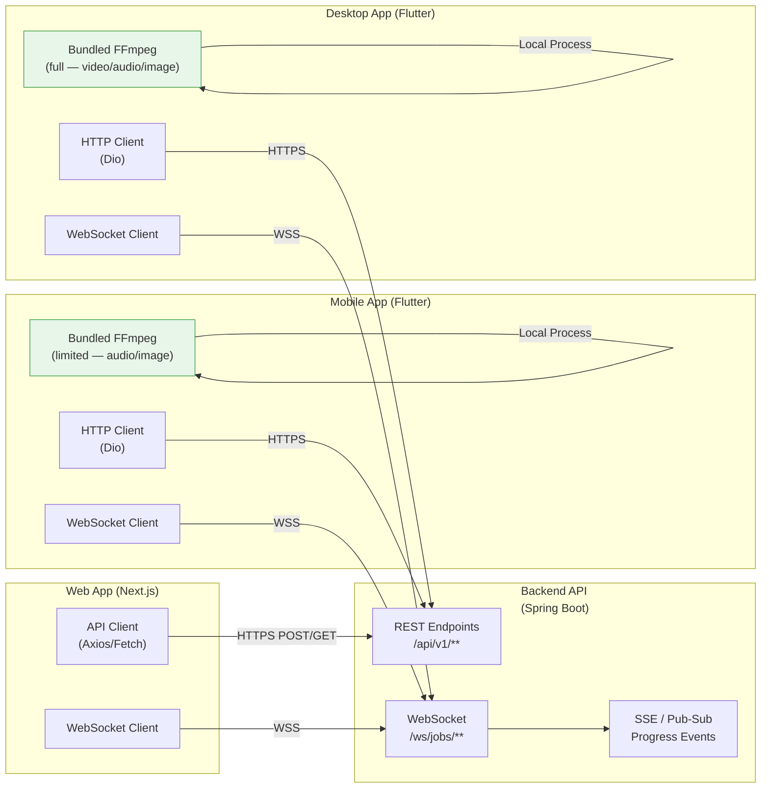
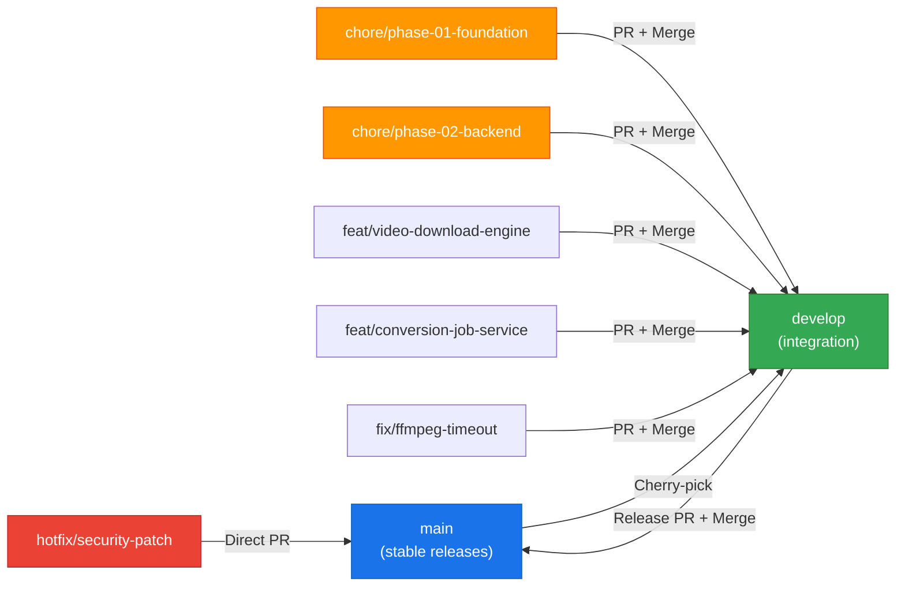

# MediaForge — Mermaid Diagrams

**Document Version:** 1.0.0
**Phase:** 01 — Foundation & Architecture
**Last Updated:** 2026-11-09

> All diagrams are written in [Mermaid](https://mermaid.js.org/) syntax and can be rendered in GitHub, the Mermaid Live Editor, or any compatible Markdown viewer.

---

## Diagram 1 — Overall System Architecture



---

## Diagram 2 — Social Media Downloader Workflow



---

## Diagram 3 — Online Media Converter Workflow



---

## Diagram 4 — Offline Media Converter Workflow



---

## Diagram 5 — Website / Mobile / Desktop Communication



---

## Diagram 6 — GitHub Branching Workflow



---

## Diagram 7 — High-Level Use Case Diagram

```mermaid
flowchart TD
    GUEST["👤 Guest User"]
    USER["👤 Registered User"]
    ADMIN["👤 Administrator"]
    SYSTEM["⚙️ System\n(Scheduled Tasks)"]

    subgraph DOWNLOAD["Download Features"]
        UC1["Paste & Analyze URL"]
        UC2["Select Quality & Format"]
        UC3["Download Media File"]
        UC4["Track Download Progress"]
        UC5["Cancel Download"]
    end

    subgraph CONVERT["Conversion Features"]
        UC6["Upload File Online"]
        UC7["Configure Conversion Options"]
        UC8["Start Online Conversion"]
        UC9["Convert Offline (Desktop/Mobile)"]
        UC10["Track Conversion Progress"]
        UC11["Download Converted File"]
    end

    subgraph BATCH["Batch & Queue"]
        UC12["Create Batch Job"]
        UC13["Manage Job Queue"]
        UC14["Retry Failed Job"]
    end

    subgraph ACCOUNT["Account Features"]
        UC15["Register Account"]
        UC16["Login / Logout"]
        UC17["View History"]
        UC18["Save Preferences"]
        UC19["Delete Account"]
    end

    subgraph ADMIN_FEATURES["Admin Features"]
        UC20["View System Metrics"]
        UC21["Manage Users"]
        UC22["Configure Adapters"]
    end

    subgraph SYS_TASKS["System Tasks"]
        UC23["Clean Up Expired Files"]
        UC24["Retry Stalled Jobs"]
        UC25["Send Notifications"]
    end

    GUEST --> UC1
    GUEST --> UC2
    GUEST --> UC3
    GUEST --> UC4
    GUEST --> UC5
    GUEST --> UC6
    GUEST --> UC7
    GUEST --> UC8
    GUEST --> UC9
    GUEST --> UC10
    GUEST --> UC11
    GUEST --> UC15

    USER --> UC1
    USER --> UC2
    USER --> UC3
    USER --> UC4
    USER --> UC5
    USER --> UC6
    USER --> UC7
    USER --> UC8
    USER --> UC9
    USER --> UC10
    USER --> UC11
    USER --> UC12
    USER --> UC13
    USER --> UC14
    USER --> UC16
    USER --> UC17
    USER --> UC18
    USER --> UC19

    ADMIN --> UC20
    ADMIN --> UC21
    ADMIN --> UC22

    SYSTEM --> UC23
    SYSTEM --> UC24
    SYSTEM --> UC25
```



---

## Diagram 8 — Database Conceptual ERD

```mermaid
erDiagram
    USERS {
        uuid id PK
        string email UK
        string password_hash
        string display_name
        string role
        boolean email_verified
        boolean active
        timestamp created_at
        timestamp updated_at
        timestamp last_login_at
    }

    JOBS {
        uuid id PK
        uuid user_id FK
        string session_id
        string type
        string status
        string input_format
        string output_format
        text source_url
        string original_name
        bigint file_size_bytes
        integer progress
        text error_message
        integer retry_count
        string input_file_key
        string output_file_key
        timestamp created_at
        timestamp updated_at
        timestamp completed_at
        timestamp expires_at
    }

    CONVERSION_OPTIONS {
        uuid id PK
        uuid job_id FK
        string option_key
        string option_value
    }

    SOURCE_ADAPTERS {
        string id PK
        string name
        boolean enabled
        string version
        timestamp created_at
    }

    USER_PREFERENCES {
        uuid user_id PK_FK
        string default_video_format
        string default_audio_format
        string default_image_format
        boolean notification_email
        timestamp created_at
        timestamp updated_at
    }

    REFRESH_TOKENS {
        uuid id PK
        uuid user_id FK
        string token_hash UK
        timestamp expires_at
        boolean revoked
        timestamp created_at
    }

    USERS ||--o{ JOBS : "creates"
    USERS ||--o| USER_PREFERENCES : "has"
    USERS ||--o{ REFRESH_TOKENS : "owns"
    JOBS ||--o{ CONVERSION_OPTIONS : "has"
```

