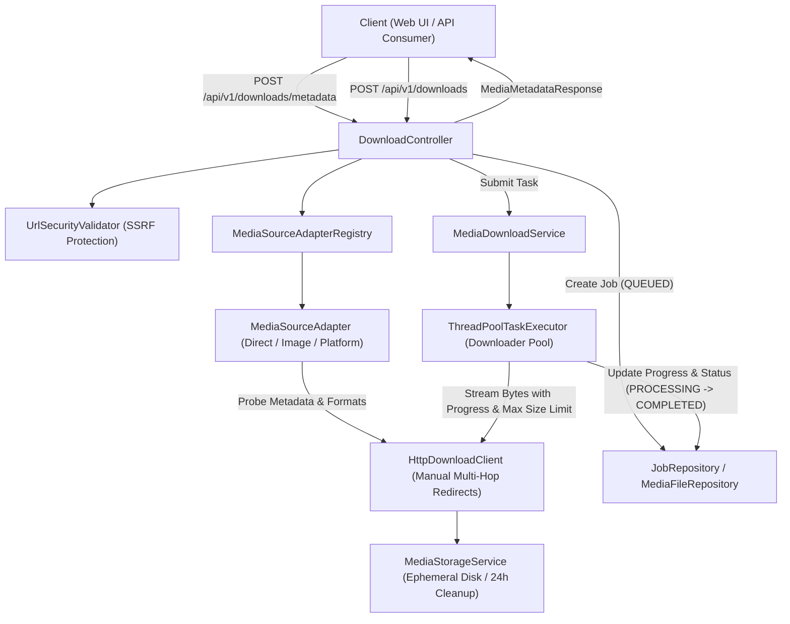

# MediaForge Downloader Engine Architecture

## 1. Executive Overview

The **MediaForge Downloader Engine** is an asynchronous, modular ingestion subsystem designed to inspect, validate, and download authorized audio, video, and image streams from remote network hosts into MediaForge's local ephemeral storage pipeline.

Built on **Spring Boot 3.5.x** with a pluggable adapter architecture, the engine isolates stream retrieval from encoding, ensuring that download operations run non-blockingly while upholding strict server-side request forgery (SSRF) defenses, stream size limits, and cooperative task cancellation.

---

## 2. Core Architectural Components

### 2.1 Pluggable Adapter Pattern (`MediaSourceAdapter`)
Media source resolution is handled dynamically through ordered, registered adapters:
- **`MediaSourceAdapter`**: Interface defining `supports(URI)`, `extractMetadata(URI)`, and `download(DownloadTask, ProgressCallback)`.
- **`MediaSourceAdapterRegistry`**: Detects matching adapters via `@Order` priority.
- **`DirectMediaSourceAdapter`** (`@Order(100)`): Inspects direct video/audio files (`.mp4`, `.webm`, `.mkv`, `.avi`, `.mov`, `.mp3`, `.wav`, `.flac`, `.aac`, `.m4a`, `.ogg`) using HTTP header inspection and container parsing.
- **`DirectImageSourceAdapter`** (`@Order(200)`): Handles high-resolution direct images (`.jpg`, `.jpeg`, `.png`, `.webp`, `.gif`, `.bmp`, `.svg`).
- **`PlatformMediaSourceAdapter`** (`@Order(300)`): Intercepts social/video platforms (YouTube, TikTok, Instagram, Twitter/X, Facebook) to uphold API terms of service, DRM, and compliance restrictions without bypassing provider protections.
- **`GenericWebSourceAdapter`** (`@Order(1000)`): Fallback adapter for web streams.

### 2.2 Security & Network Client (`HttpDownloadClient` & `UrlSecurityValidator`)
- **Defense-in-Depth SSRF Validation**: Target URLs and every subsequent HTTP 301/302/307/308 redirect hop are validated against DNS rebinding, RFC 1918 private subnets, loopback interfaces (`127.0.0.0/8`, `::1`), link-local addresses, and cloud provider metadata IPs (`169.254.169.254`, `metadata.google.internal`).
- **Disabled Automatic Redirects**: The HTTP client turns off native redirect following (`setInstanceFollowRedirects(false)`) and manually validates target URIs at every hop before opening new connections.
- **Enforced Payload Caps**: Stream byte sizes are monitored in real time; any transfer exceeding `app.downloader.max-file-size` (default 500 MB) is immediately aborted.

### 2.3 Asynchronous Execution Engine (`MediaDownloadService`)
- Dedicated Spring `ThreadPoolTaskExecutor` (`downloaderTaskExecutor`) with configurable core pool, max pool, and queue capacity.
- Non-blocking job lifecycle:
  1. `QUEUED`: Job record persisted in PostgreSQL; task submitted to worker pool.
  2. `PROCESSING`: Stream connection opened, bytes written to scratch storage, progress reported periodically.
  3. `COMPLETED`: Permanent file moved to storage repository, `MediaFile` entity recorded, linked to `outputFileId`.
  4. `FAILED`: Clean up partial files, record error reason.
  5. `CANCELLED`: Worker aborted via cancellation flag, partial download deleted immediately.

### 2.4 Ephemeral Storage Subsystem (`MediaStorageService`)
- Strict path traversal protection: Ensures all temporary and permanent storage paths are canonicalized and reside inside configured storage roots (`mediaforge_data/downloads`).
- Scratch isolation: Active downloads stream to `temp/` scratch files before atomic relocation to final media directories upon verified completion.
- Automated 24-hour TTL cleanup: Scheduled cron task purges expired downloads and temporary files older than retention policy.
